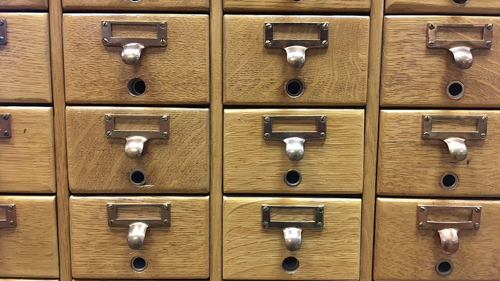

大学图书馆搬过一次家。新馆全数字化，老馆二楼那排木质卡片目录柜没人要，堆在走廊里等清运。我路过时拉开一个抽屉，里面卡片还在，淡黄色的，边角磨圆了，按拼音字母排得整整齐齐。

那一刻我有点舍不得。这套东西笨重、占地方、查一本书要走过去、拉开抽屉、用手指拨卡片。可它有一个现在很多整理方式都没有的品质：**你站在它前面，就知道该往哪儿找。**

*题图来自 Wikimedia Commons，摄影 MarkBuckawicki（CC0）*

## 按来源分类，是最省事也最没用的分法

我以前的下载文件夹是最好的反例。里面按来源分：官网下的、群里传的、邮件附件、从某个项目拷过来的。分类的时候毫不费力——东西从哪来，就往哪放。三个月后要找一个文件，我站在那四个文件夹前，一个也想不起来。

问题不在于分类不整齐，而在于它回答的是"这东西怎么来的"，而我要问的是"这东西能干什么"。

**按来源分类的分母是过去，按用途分类的分母是未来。** 整理是为了以后，不是为了记账。

## 你找东西时，脑子里冒出来的是场景

我后来观察自己找东西的过程，发现很一致：想找某个脚本，我心里的句子是"那个批量改图片尺寸的"；想找某份笔记，是"上次算年终奖的那个表"。全都是用途和场景，没有一次是"从某个网站下的那个"。

这就是卡片目录柜厉害的地方。卡片上有作者、有书名，但排卡片用的是**主题词**——你要找的是关于某个主题的书，卡片就是按这个排的。

于是我改了规则：文件夹按"我要用它做什么"命名，不按"它从哪来"。同一份东西如果两个场景都用得上，就选更常用的那个，另一个位置留一个指路的小文件。宁可多写一行指路，也不要把它复制两份——复制的东西会分叉。

## 抽屉数量有上限，这是好事

老目录柜的抽屉是固定的，一排五个，一共多少排也是死的。这个限制逼着图书馆员不停地把相邻的主题合并，直到每个抽屉里都装得下。

我现在给每个目录树定的规矩也很硬：**同级目录不超过七个，多出来的必须合并或者下沉。** 七个不是玄学，是手指能一次扫完的数量。超过七个，找东西就从"看一眼"变成"读一遍"。

限制的另一个好处是它会逼你做取舍。没有上限的时候，分类永远可以再加一层；有上限，你就得回答一个更诚实的问题：这两样东西，真的需要分开吗？

> 分类不是为了把东西放进去，是为了让你能再拿出来。

## 写在最后

那排卡片柜最后还是被清走了。我没留下什么，只在心里记了一件事：一套好的索引，用起来是无声的——你不会赞叹它设计得多巧，你只是每次都很快找到。

收拾东西的时候别问"这该放哪"，问"下次我会怎么想起它"。

答案通常不一样。