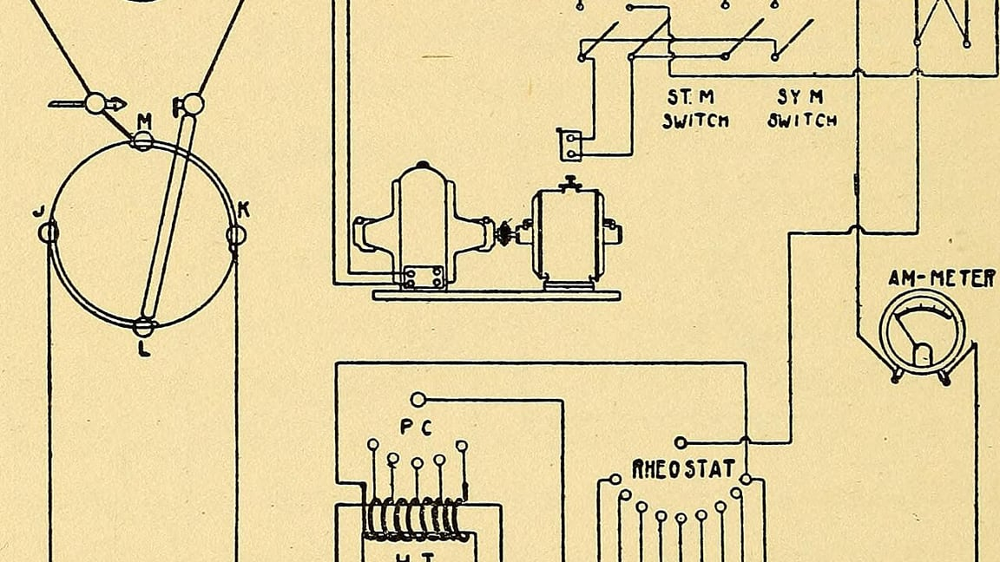

我电脑里存着一份 1917 年的扫描件，是一本 X 射线技术手册的内页。纸张已经黄得像旧信封，画的是电路：一个圆形的转换器，几个开关，一个绕线电阻，右上角还有个安培表，指针朝右下偏。

一百多年过去了，我不懂 X 射线机，但我看得懂这张图。哪个是开关，哪个是表，电流从哪儿进从哪儿出，全标出来了。

*题图来自 Internet Archive Book Images，无已知版权限制（公有领域）*

## 熟悉会让你说不出重点

写文档最难的不是写字，是假装自己什么都不知道。

我改过一个自己半年前写的脚本。那个脚本有一段诡异的兼容处理，我当时肯定知道为什么，因为我在上面写了一行注释：`// 特殊处理`。

就这六个字。特殊在哪、不这么写会怎样、什么条件下可以删掉，一个字都没有。我盯着它看了二十分钟，最后的选择是——不敢删，原样留着。

**默认读者和你共享上下文，是文档失效最常见的原因。** 而这个默认几乎总是错的：三个月足够忘干净，半年足够忘到怀疑是不是自己写的。

## 图比段落活得久

那份老手册之所以还能用，很大程度上是因为它画了图。文字会随语言和术语一起腐朽，图不会——图自带上下文，你看见开关，就知道那是开关。

这给了我一个很实用的判据：**能用一张图讲清的结构，别用三段话描述。** 目录树、请求链路、状态流转、页面结构，这些东西用文字写出来既长又容易误会，画成几行箭头反而一眼就明白。

我现在写稍微复杂一点的东西，都先画一个粗糙的框线图，哪怕只有几个方块和箭头，然后再围着图写说明。写的时候也轻松，因为不用再费劲描述结构，只需要解释图里看不出来的部分——为什么这么连、哪里踩过坑。

## 该写的和不该写的

我给自己定了几条：

- **写为什么，不写是什么。** 代码自己会说它做了什么；只有你知道它为什么这么做。
- **写放弃的方案。** "本来想用 A，但 A 在某个场景下会失败，所以换成 B"——这句最有价值，因为它省掉了下一个人重走一遍的时间。
- **写怎么验证。** 一段说明如果不带验收方法，读者只能选择相信或者不相信。
- **不写显而易见的步骤。** "点击保存按钮"这种话占位置，还稀释了真正的重点。

> 写给懂的人看的文档，等于没写。

## 写在最后

那张扫描件我一直没删，纯粹因为好看。但它确实改变了我写东西的习惯：每次落笔前先问一句——三个月后的我，还记得现在这些吗？

如果不记得，那就当他是陌生人，从头讲。

陌生人不会嫌你啰嗦，只会嫌你省略。