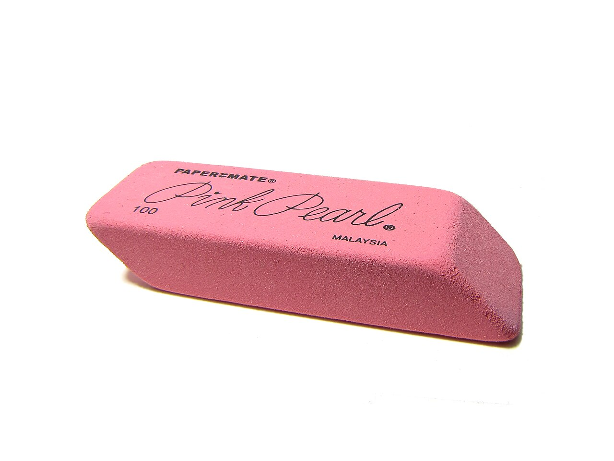

小学写字课上，老师有一条规定：作业本要保持整洁，不许涂改。于是全班都有同一套动作——写错一个字，先用手掌压住纸角，再用橡皮按住那块，一下一下地蹭，蹭到纸面微微发毛，还不能破。

那时候橡皮是个扫尾工具：先写，写错了再擦。

后来我发现，它的作用其实是反过来的。

*题图来自 Wikimedia Commons，摄影 ZooFari（公有领域）*

## 擦得掉，才敢往下写

我写字有个毛病：写到一半卡住。卡的不是内容，是那个"万一这词不合适"的犹豫。铅笔写字的人不太有这个问题，因为写下去是有退路的，橡皮就放在手边。

**能撤销的东西，人才敢第一时间下手。**

这一条在纸上只是小事，在别的地方就是大事。我改稿子时，用铅笔草稿的速度大约是直接敲键盘的两倍——不是因为写字快，而是因为不用在每一句上停下来判断"这样写行不行"。判断留到第二遍，那时手里有全文。

## 删代码是同一件事

写代码也是这样。刚开始那两年，我很少删东西，宁可注释掉放在那儿——万一以后要用呢。代码越堆越长，改一处要绕着七八个已经不用的分支走。

后来我强迫自己每周清一次死代码。第一次删的时候手是抖的，删完还留着 git 历史翻了三遍。翻完就明白了：**代码的退路是版本控制，不是注释块。**

有了退路，写的时候就不必为"以后可能要改回来"预留空间。写第二版时，我几乎不写兼容旧逻辑的分支。

## 橡皮不解决判断

不过这里有个容易滑过去的坑。有了橡皮，有人写得更草率，反正能擦；有了版本控制，有人提交得更随意，反正能回滚。

工具给的是自由，不是判断力。橡皮让你敢写第一遍，但它不告诉你哪一个字该留。**能不能擦掉，回答的是"敢不敢动手"，能不能看清，才是"对不对"。**

所以我现在的习惯是：草稿阶段用最快的方式写，写完先放一放，再回来当陌生人读一遍。那一遍里，橡皮已经用不上了——问题不在错别字，在整段该不该存在。

## 写在最后

那块橡皮很多年没用了。但写字之前先找一块放在手边这个动作，我保留到了现在——写文档、写代码、写提纲之前，先确认退路在哪。

> 有退路的地方，才敢用力。

退路不是为了让错继续存在，是为了让第一步不那么重。
