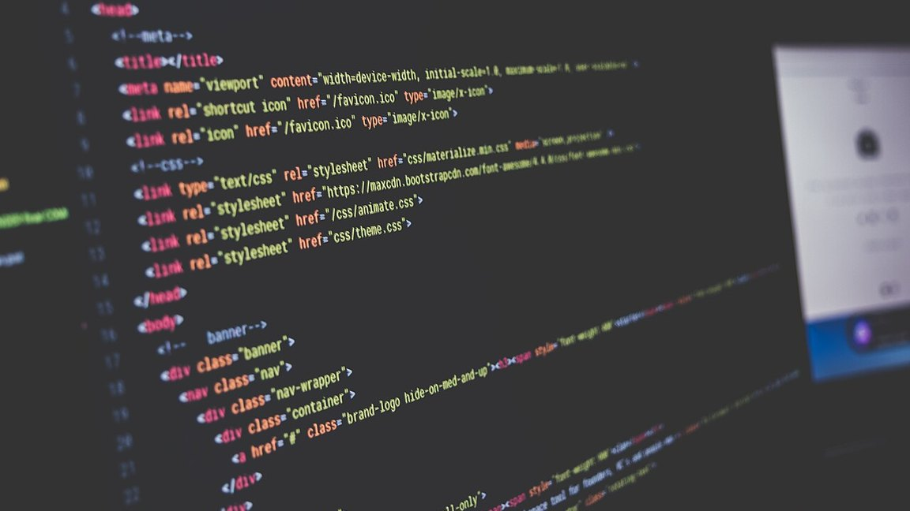

把博客的阅读列加宽之后，我以为问题解决了。结果打开 1440 宽的窗口一看：正文确实宽了一点，但整块内容仍然贴着左边，右边空出一大片。

宽度不是问题的全部。**问题从来不是"窄"，是"偏"。**



*题图来自 Wikimedia Commons，摄影 Sai Kiran Anagani（CC0）*

## 空白是算出来的，不是漏出来的

先量。视口 1440，正文列 544 像素，两侧各剩下 430 左右的空隙。这个数字不是设计失误，是除法的结果：阅读列必须定宽。

定宽的理由很实际——中文一行三十字左右最好读，34rem 差不多就是三十字。屏幕再宽，一行六十字的正文会让人读到行尾找不到下一行的开头。所以不管屏幕多宽，正文的宽度是锁死的。

那么"宽屏 = 右侧空白"就是必然的。**真正要决定的不是要不要有空白，是这块空白分配给谁。**

## 靠左对齐，眼睛每次都要重新找起点

第一版我试的是"填满"：左边加目录，右边加推荐，中间塞正文。填是填上了，但读起来更累——三块东西抢注意力，而且正文被推到偏右，视线落点每次都得重新计算。

第二版试了"靠左、把目录放右栏"。空白是小了，但视线仍然要从窗口左侧三分之一处开始。窗口越宽，这个起点离视野中心越远，眼睛每读一行都要往左拽一次。

后来换成把正文放回中线：三列等宽网格，左边留白、中间正文、右边目录。

```css
.post {
  display: grid;
  grid-template-columns: 12rem minmax(0, 34rem) 12rem;
  justify-content: center;
  column-gap: 3rem;
}
```

左边那一列**什么也不放**。它的唯一职责是和右边等宽，把中间那一列顶回视口中央。

**让一列空着，是一件需要主动去做的事。**

## 对称不产出信息，但它省力

这看起来像是为了好看牺牲了空间。但省下来的不是像素，是视线移动的距离。

一篇文章从第一行读到两百行，是两百次"从这一行的结尾跳回下一行的开头"。如果开头固定在视野中央偏左，这个跳跃幅度最小；如果开头在窗口最左边，每一次跳跃都要跨过整片空白再回来。

读者不会说出来，但身体知道。**排版的好坏常常表现为"读得下去"和"读两段就想关掉"。**

## 别扭的地方

改成网格之后，目录从 `position: fixed` 换成 `position: sticky`——它必须真的待在那个格子里，而不是飘在窗口上。这一改，滚动到底部时目录会跟着正文走，不再一直停在屏幕角上。

还有一处：手机上必须退回原样。三列在 390 宽的屏幕上是灾难，所以断点之下整块退出网格，目录变回抽屉。

> 布局里每一处"对称"，背后都要有一份"不对称"的兜底。

## 写在最后

改完之后我又量了一遍：正文的中线正好落在视口中线上，左右留白相等。

数值上它什么都没多给——字还是那么多字，图还是那么大图。但打开页面的第一眼不再觉得空了一边。

宽屏下的空白不是要填满的空，是要分配的空。
