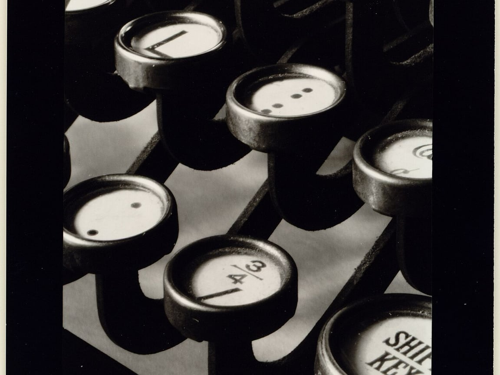

老式打字机的键是圆的，黑底白字，排成一个斜着的方阵。按下去要用点力，抬起来会有一声脆响，字模砸在色带上，纸面上留下一个略深的印子。

我第一次用是在一个旧物市场，摊主让我随便敲。敲了十几个键我就发现了问题：常用的字母散得很开，不常用的反而聚在顺手的地方。

摊主说，这叫 QWERTY，一百多年前为了不让打字杆卡住定的，早就不用改了。

*题图来自 Wikimedia Commons，摄影 Ralph Steiner（公有领域）*

## 工具的默认值，往往有它自己的历史

QWERTY 的来历很多人都知道：早期的机械打字机，相邻键同时按下去，字杆会撞在一起卡住。于是设计者把常用字母打散，让打字速度慢下来。

后来机械结构改了，卡键早不是问题，但排列留下来了。换成别的布局要重新学，成本太高，于是就这么用了一百多年。

**很多工具的"不合理"，是别处的合理留下的痕迹。**

鼠标的右键菜单、键盘的 Ctrl 位置、命令行里那些短得莫名其妙的参数——都是这样。它们不为今天的你优化，它们为当初定下它们的那个人优化。

## 先学，再判断

我有个阶段特别爱改配置。编辑器换主题、改快捷键、装插件，调得顺手之后很有成就感。

但调多了我发现一个问题：**配置调得越久，用工具的固定动作就越少。** 每次遇到不顺的地方，我的第一反应是"怎么改掉它"，而不是"它为什么这样"。

改变发生在一次协作里。同事用我的机器，敲了一个我从来不知道的快捷键，屏幕上跳出一整块我找了很久的功能。那一瞬间我意识到，我花在改配置上的时间，可能比学它自带功能的时间还多。

后来我给自己定了个顺序：先用两周默认值，真正卡住了再改。两周下来，很多"不顺"其实是不熟，熟了就顺了。

## 但也不是全都该忍受

不过这条不能走到极端。有些默认值是真的不合理，尤其是安全问题、可访问性、数据丢失这类——那不是在适应，那是在容忍缺陷。

判断标准我总结成一句：**如果不顺来自习惯，就去适应；如果不顺来自设计缺陷，就去改。**

前者比如某个快捷键不顺左手，练练就好。后者比如默认不保存、默认覆盖、默认不提示，那是真的会让你丢东西。

## 写在最后

那台打字机后来我没买，太占地方。但那次敲击留下一个印象：工具是硬的，人是软的。

用久了会发现，绝大多数"不好用"，都是还没用熟。真正需要改的地方没那么多，而且通常一眼就能看出是缺陷。

> 先把工具用旧，再决定要不要改它。
