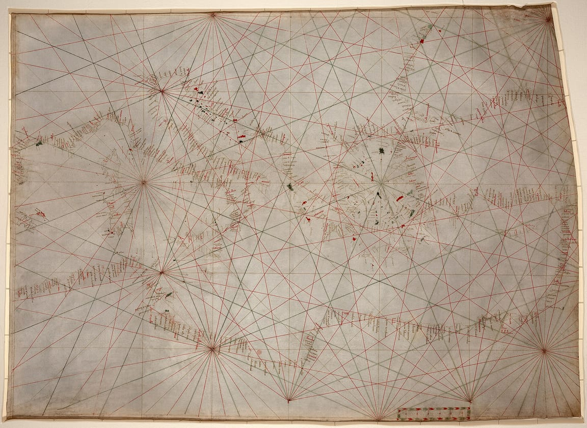

我很喜欢看老地图。

中世纪的海图很有意思：海岸线画得很准，港口标着名字，整张图上还铺着一层层放射状的红线——那是罗盘方位线，从各个方向中心向外散开。

但图上没有一条线告诉你"从这里到那里应该怎么走"。那是领航员自己的事，他得看风、看浪、看季节。

*题图来自 Wikimedia Commons，十四世纪热那亚佚名绘（公有领域）*

我一直觉得这比现代导航软件诚实。

## 全知的路线不存在

有一阵子我做周计划做得很细，精确到每天上午干什么、下午干什么，还很得意——安排得多清楚。

实际执行下来，通常周二就崩了。一次临时会议、一个报错、一场没睡好的觉，就能把整周的格子推翻。推翻之后我不会重排，只会觉得"这周废了"。

问题不在执行，在我把地图当成了路。**地图给的是关系，路要靠当天的情况现走。**

## 排得越细，崩得越快

后来我改了个笨办法：一周只定三件事，写完就关掉计划文档。剩下的时间怎么分，当天早上再排。

这个改动的效果出乎意料。三件事是可数的，所以每天都能回答"今天有没有推进"；而剩下的空白不再被当成失败，它本来就是留给意外的。

> 计划的价值在于挑出不能丢的那几条，不在于把时间填满。

我把这个叫"留出余量"，但更准确的说法是：**把小目标当成方向，而不是行程。**

## 方向要少，而且要硬

不过"少做计划"不等于"不做计划"。区别在哪儿，我花了一段时间才想清楚。

好的方向有个特征：它能在你犯错的时候把你拉回来。比如"这个月只做一件事：把编辑器换成新的"，这句话管用，因为它能挡掉别的东西——有人约你写个新功能，你可以说这个月不行。

而"这个月提升效率"就没有这个力量。它什么都对，所以什么都约束不了。

**能挡掉东西的方向才是方向，挡不掉的是愿望。**

## 写在最后

罗盘玫瑰画在纸的中央，四周是海。它不告诉你哪条路好走，只告诉你北在哪。

我现在给自己定目标，尽量只写北在哪儿——剩下那些航线、风向和暗礁，走到那天再说。

> 计划的意义，是在混乱里还剩几个不肯让步的坐标。
