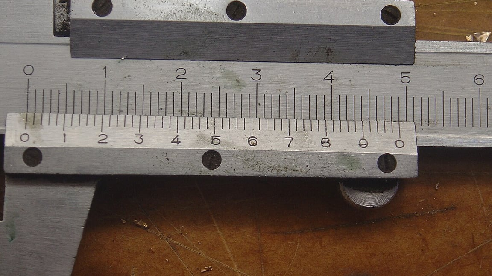

我爸是钳工出身，家里有一把游标卡尺，铜的，装在一个绒布盒子里。小时候我拿它当玩具，被他训过一次：卡爪不能当夹子使，会磨坏。我当时不明白，一个量东西的铁片，为什么比别的工具都金贵。

后来才知道，卡尺之所以被供起来，是因为它把"差不多"变成了一个数。

*题图来自 Wikimedia Commons，摄影 Peter Southwood（CC BY-SA 3.0）*

## 眼睛会骗人，而且骗得很系统

我搬过几次家，每次买书架都栽在同一个坑里：站在墙前目测，觉得"这一面墙放个一米八的没问题"，买回来立起来，顶上还空着一大截，或者干脆进不去电梯。

不是眼神差，是人的眼睛在估计长度这件事上有个稳定的偏差——越远越不准，越斜越不准，而且偏的方向还一致。所以凭感觉猜十次，得到的不是十个随机数，是十个都往同一侧歪的数。

写代码时也一样。我记得很清楚，有一次判断某个页面的首屏图片"太大了，加载肯定慢"，于是动手换成更小的尺寸。改完一测，快了两毫秒。

**凭感觉做出的优化，有一半的力气花在了没坏的地方。**

## 量一次，抵得上猜十次

真正让我改掉习惯的，是一次等脚本跑完的事。那阵子每次跑完一轮检查，我都觉得"要等好久"，估摸着半分钟往上，于是认真盘算过要不要把它拆成两半并行跑。某天顺手加了一行时间戳打印，结果是 4.7 秒。

4.7 秒和 30 秒，不是一个量级的问题，对应的解法也完全不同：前者根本不用管，后者才值得折腾。如果我按"感觉慢"去优化，可能花一个下午把流程拆了个遍，最后发现只是自己没耐心。

量的价值不在于精确到小数点后两位，而在于把判断从"好像"挪到"是/不是"上。你知道是 4.7 秒，就不用再讨论它慢不慢；你不知道，讨论就只能靠声调。

> 猜十次不叫经验，量一次才叫知道。

## 不是什么都值得量

不过我也走过另一头：有那么一阵子，什么都想加个指标。写个脚本计时，统计每篇文章的字数、每张图的体积、每次提交改了几行。数据记了一堆，一个问题也没解决。

后来想明白了，量的成本也是成本。一个数只有当它能改变你的动作时才有意义——量出来发现有病，你能治；量出来是健康的，那这次测量就只是买了点安心。前者值，后者要看安心有多贵。

所以我现在的做法很朴素：**准备动手改的东西，先量一次；不打算改的东西，不量。**

## 写在最后

那把卡尺后来归我了。我其实很少用它，但不舍得扔——它放在抽屉里，提醒我一件事：目测是一种偷懒，而偷懒在判断上最贵。

能用一个数说清的事，别用感觉吵。