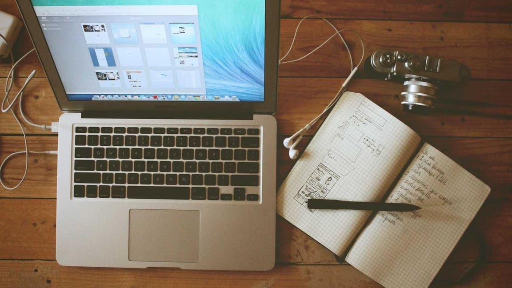

自己天天用的站，出问题还是得靠别人撞上。

那天我在文章页底部，顺手点了一下页脚那个「RSS 订阅」链接。页面跳过去了，但落点不是订阅页顶部——是最底部，页脚那个位置。

鼠标点了三次，三次都这样。



*题图来自 Unsplash，摄影 Galymzhan Abdugalimov*

## 先怀疑最常见的那个

第一反应是滚动位置恢复出了问题。浏览器的后退恢复、前端的 scroll restoration，这类东西最爱在这种时候捣乱。但这是前进导航，不是后退，而且项目里没写过任何滚动恢复的代码。

于是打探针：在跳转前把 `scrollTo(0, 0)` 记一笔，再监听换页事件。

```
scrollTo   y=0
page-load  y=0
scroll     y=13 … → y=832（26 次）
```

关键在最后一行：**不是没滚到顶，是滚到顶之后又被推下去了。**

那就不是滚动的问题，是有人在滚。

## 是谁在滚

去翻框架源码。换页时有一段 `saveFocus()`，逻辑是：如果当前焦点元素在一个被标记为"跨页保留"的容器里，换页后把焦点还给它。

页脚恰好就是这样一个容器——它要在所有页面之间保持不变，所以标了 persist。

而页面跳转时，鼠标点过的那条链接还带着焦点，焦点元素在页脚，页脚在页面最底部。框架把焦点还给它，浏览器为了让焦点可见，把页面推到了底。

**浏览器没做任何多余的事。它只是把上一次的指令，在错误的时机重放了一遍。**

## 第二个同类

顺着这条线又找到一个：归档页的分页按钮。

键盘操作——Tab 到"下一页"，回车——落在第 2 页的 y=129，页面会抖一下。鼠标点则完全正常。

这个不是焦点恢复，是全局的 `scroll-behavior: smooth`：新页面渲染时那次"回到顶部"被平滑动画接管，动画还没走完，浏览器的锚点处理插了一脚。

## 修复：三个小动作

写了一个不到七十行的小脚本，三段各管一段：换页完成后强制把滚动归零，压掉平滑动画的尾巴；点击发生在"跨页保留"容器里的链接时，先让那个元素失焦；键盘触发的翻页，用 instant 而不是 smooth。

没有删掉全局的平滑滚动——归档页的年份锚点靠它，删了那里就变成硬跳。

**把一个行为的触发条件收窄，比把它整个关掉安全得多。**

## 加断言

这类 bug 最难的地方是"它只在特定路径上出现"。鼠标点不出来，键盘能；点页脚能，点页头不能。

所以断言也照着路径写：模拟点页脚链接、模拟键盘聚焦后回车，分别检查落点。然后再做一遍故障注入——把两段修复分别删掉，确认各自能让对应那条断言转红。删左边红左边，删右边红右边，不误伤。

> 一个 bug 修好的标志，不是它不再出现，是它出现时有人会喊。

## 写在最后

整件事里最有意思的是起点：我以为问题在"页面没滚到顶"，实际上问题是"页面滚到顶了，然后被赋予了第二次滚动"。

排查的思路就是一路缩小责任范围：不是滚动恢复，不是前进导航，不是样式——最后落在一个十二行的焦点函数上。

**先确定是谁在动，再决定让它别动。**
