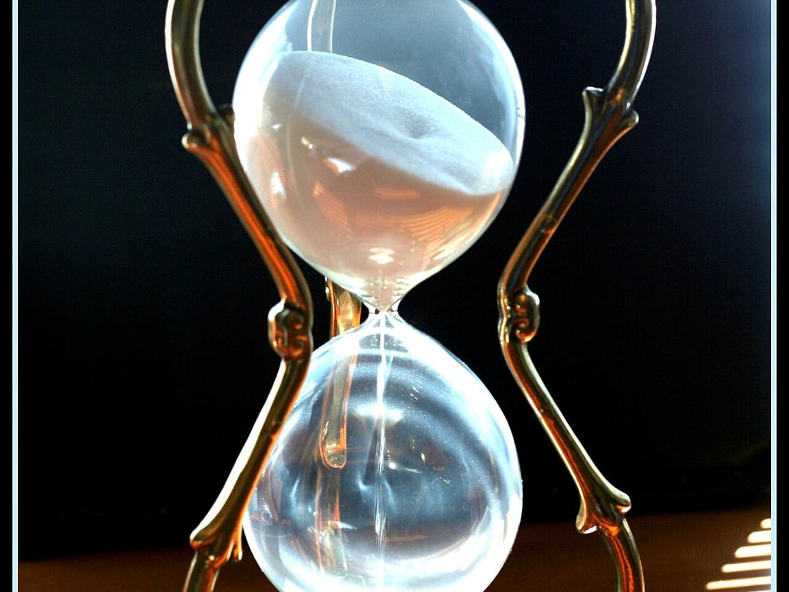

我有一套跑得挺慢的检查脚本，全跑一遍大约四分钟。

最初我特别不能忍这四分钟。任务栏切来切去，翻两页消息，点开一个视频，回过神来脚本早跑完了，可刚才想干什么已经忘了。

后来我把这四分钟改了用法，情况完全不同。

*题图来自 Wikimedia Commons，摄影 John Morgan（CC BY 2.0）*

## 空档时间最容易被填坏

人对"等待"有种天然的敌意，觉得那是不该存在的空白，必须赶紧塞点什么。

问题在于，塞进去的东西通常是最轻的东西——刷消息、翻帖子、看两眼新闻。它们有个共同点：**开始容易，结束没有边界。** 四分钟的等待，很容易变成二十分钟的走神。

更糟的是切换成本。从写代码切到看消息，再从消息切回代码，重新捡起上下文的代价比那四分钟本身高得多。

## 等待是一种可用的时间

我后来做了两件小事。

第一，把等待变成明确的块。脚本一开始跑，我就站起来，去倒水、走两步，或者什么都不干，站着看窗外。这段时间不计入工作，也不打算产生什么。

第二，如果不想离开座位，就只做**不需要上下文的事**：整理一下待办、回一封两句话的邮件、看看刚才那个报错的具体信息。关键是这些事情收尾干净，不拖尾。

这两件都不高明，但合起来解决了一个大问题：等待不再是一个需要"填满"的洞。

## 慢工具有它的好处

还有一层。

以前我追求构建越快越好，恨不得改一行代码就热更新到位。快当然好，但那种"改一行看一行"的节奏，会让人不自觉地小步试探，从不退后一步看整体。

四分钟的等待反而逼出了整块的思考。代码在跑，人在想，想的是"这整套东西到底对不对"——这个念头在快速的循环里是不会冒出来的。

**慢下来的那几分钟，常常是唯一能想大问题的时候。**

## 写在最后

所以我现在的判断标准变了：不再问"这个等待能不能消掉"，而是问"这段时间我打算用来做什么"。

有些等待确实该优化掉——比如跑一次要半小时的流程，那是真的浪费。但四分钟的四分钟，去掉它并不划算；把它当成工作的一部分，反而能换回点东西。

> 时间不是只有被用掉和浪费掉两种结局，还有一种是被允许。

允许它慢一点，它才还你一个能想事情的空档。
