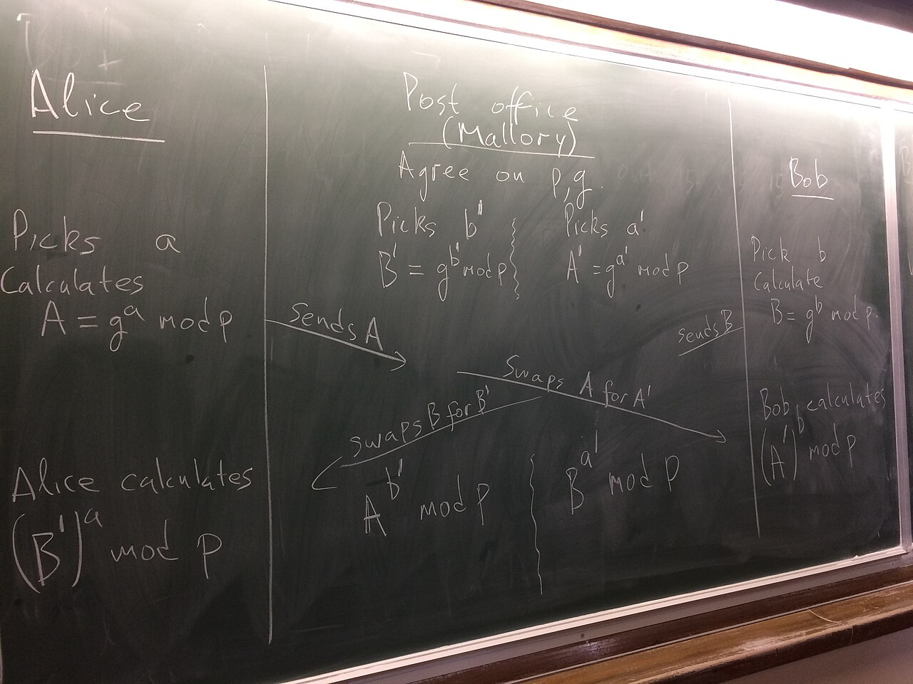

公司会议室有块很大的白板，写满过很多次。

讨论的时候，七八个人挤在前面，箭头、方框、被划掉的方案、突然冒出来的补充，写得密密麻麻。第二天早上再进去，白板已经干干净净，连边框都擦过。

没有人觉得那些内容被浪费了。该留下的，当场就进了会议纪要或者某个人脑子里；不该留下的，本来就是过程。

*题图来自 Wikimedia Commons，摄影 David Malone（CC BY 4.0）*

## 白板之所以好用，正因为它会消失

我后来想明白，白板的可擦性不是它的缺点，恰恰是它最大的优点。

写上去之前，你会想：反正一会儿就擦了，先写下来看看。于是一个不成熟的想法也敢往上画。画出来之后，别人可以在这上面改、打叉、接一句。整个过程是**流动的**。

如果那块板子上的东西会永久保存，事情就变了。你会先在脑子里过一遍措辞，怕写得太糙；会犹豫要不要画那条不确定的线；会有人提醒你"这个要留档"。

**永久保存的压力，会让第一版变得小心翼翼。**

## 我们把这种压力加得到处都是

但现实里，我们干的事往往相反。

代码里留下一堆注释掉的旧实现，理由是"以防万一"。文档里保留着已经废弃的流程，理由是"有历史价值"。待办清单里躺着三年前的任务，理由是"也许哪天要做"。

这些都不是白板，它们是刻在石头上的东西。而石头上的字，没人敢在上面再随手画一笔。

我印象很深的是有次接手一个模块，两千行代码里有一半是注释掉的旧逻辑。我花了整整一天确认哪些能删，删完发现剩下的一千行清楚多了。**那天整个下午我都在想：这半天时间，本可以不用花。**

## 分成两块板子

我现在的做法是把东西分成两类，放在不同的地方。

一类是需要持久的：结论、决定、为什么这么做。这些进文档和提交信息，写清楚，长期保存。

另一类是过程性的：思路、草稿、试过的死路。这些就让它待在不重要的地方——一次对话、一个临时文件、一段会被删掉的代码。用完就清，不心疼。

关键不是哪一类更重要，而是**别把过程性的东西塞进需要永久保存的位置**。位置一旦被赋予"要长期保留"的意味，写的人就会变拘谨，看的人也不敢删。

> 该擦掉的东西擦干净，留下来的才敢写重。

## 写在最后

那块白板每周擦好几次，内容从来没被记住过。有用的部分在讨论当天就转化成了别的东西，没用的部分本来就不该占地方。

我现在清代码前会问一句：这行如果还在白板上，我会擦掉吗？答案是会的话，那就删。

留下来的位置有限，得留给真正要长期挂在那儿的东西。
